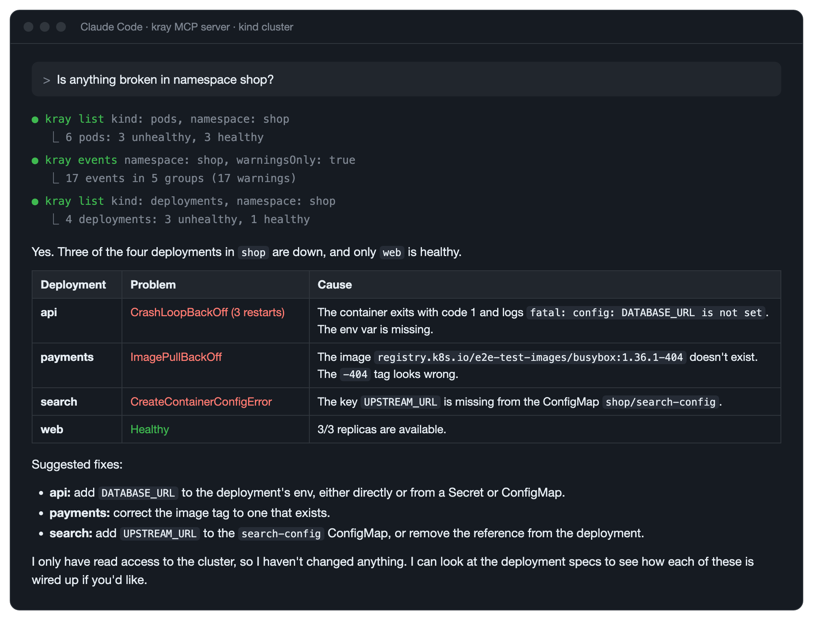

<h1 align="center">kray</h1>

<p align="center"><strong>Read-only Kubernetes CLI for AI agents. 62% less to read. Nothing to leak.</strong></p>

<p align="center">An open source project by <a href="https://www.groundcover.com/?utm_source=github&utm_medium=readme&utm_campaign=kray&utm_content=header">groundcover</a></p>

<div align="center">
  <a href="https://github.com/groundcover-com/kray/actions/workflows/ci.yml"></a>
  <a href="https://github.com/groundcover-com/kray/releases/latest"></a>
  <a href="LICENSE"></a>
  <a href="go.mod"></a>
  <a href="docs/testing.md"></a>
</div>

<p align="center">
  <a href="#quickstart">Quickstart</a>&nbsp;&nbsp;&bull;&nbsp;&nbsp;
  <a href="#how-it-works">How it works</a>&nbsp;&nbsp;&bull;&nbsp;&nbsp;
  <a href="#benchmark">Benchmark</a>&nbsp;&nbsp;&bull;&nbsp;&nbsp;
  <a href="#limits">Limits</a>&nbsp;&nbsp;&bull;&nbsp;&nbsp;
  <a href="#documentation">Docs</a>
</p>

kray is `kubectl get`, `describe`, `logs`, `events`, and `top` for AI agents, with nothing that writes. Add it to Claude Code, Cursor, or Codex as an MCP server, or call it from the shell.

In our benchmark, agents using kray read 62% fewer tool tokens than agents using `kubectl`, and found the same faults. We also planted passwords, tokens, and keys in the test cluster. Agents using `kubectl` read one of them in 48 of 115 runs. Agents using kray read none in 230 runs.

<p align="center"></p>

## Quickstart

Paste this into Claude Code, Cursor, or Codex:

```text
Install kray for me and connect it to this agent. Follow the steps in
https://raw.githubusercontent.com/groundcover-com/kray/main/docs/install.md
Use my current kubeconfig context unless I name another one.
Show me the manifests and ask me before you apply anything to the cluster.
```

Then ask your agent: "Is anything broken in this cluster?"

On the command line, write `kray` where you'd write `kubectl`, for example `kray get pods -A` or `kray logs web-1 --previous`. To install by hand, see [Install kray](docs/install.md).

## How it works

### Fewer tokens

kray reads what `kubectl` reads, then joins the facts that `kubectl` shows in separate commands. Each row carries its likely cause:

```text
NAMESPACE  NAME           READY  STATUS            RESTARTS  AGE  CAUSE
shop       api-7f9c8-x2k  1/2    CrashLoopBackOff  14        2h   container api is OOM killed at its memory limit of 1024Mi (14 restarts); memory use now: 900Mi (88% of the limit)
pay        img-1          0/1    ImagePullBackOff  0         20m  container pay cannot pull its image: the image or tag registry.example/pay:1.4.2 does not exist in the registry (not found)
```

Problems come first, healthy objects are counted, and repeated log lines collapse into one group. Each result fits 16 KiB, and a note says what was cut and how to see more. See [How kray diagnoses](docs/diagnosis.md).

### No secret values reach the model

- kray never reads Secret objects, not even their names.
- It redacts secret values in environment variables, arguments, logs, events, and annotations. Each one shows as `[REDACTED:<rule>]`, and the result header counts them.
- It fences cluster text as untrusted data, so a log line can't give your agent instructions.

### Read access only

- One transport sends every request. It allows only GET, and it blocks the `exec`, `attach`, `portforward`, `proxy`, and `secrets` paths. Tests prove it.
- A command that changes the cluster prints `This command is not supported.` and sends nothing.
- Each call writes one audit line with the tool, the redacted arguments, and the identity. The line never holds the result.
- Every kray tool only reads, so you can approve them once in your agent. With `kubectl` that isn't safe, because `kubectl get secret -o yaml` is also a get. See [Approve the tools once](docs/install.md#approve-the-tools-once).

See [Security model](docs/security-model.md).

## Benchmark

We gave the same model the same 18 faults with each tool, three runs each, on a kind cluster. The faults come from two blind sets: their authors didn't read kray's code.

| Agent's tool | Correct | Calls | Tool tokens | Saw a planted secret |
|---|---:|---:|---:|---:|
| `kubectl` | 54 of 54 | 2.0 | 1,280 | 48 of 115 runs |
| kray CLI | 54 of 54 | 1.6 | 482 | 0 of 115 runs |
| kray MCP | 54 of 54 | 2.6 | 486 | 0 of 115 runs |

The model was Claude Sonnet, on a build from before the first public release. A single task takes about as long with each tool (11.0 seconds with `kubectl`, 10.6 with the kray CLI).

To run it yourself, you need Docker, `kubectl`, Go, and the `claude` CLI. The default is the blind set: 10 faults, 3 tools, and 3 runs, so 90 agent tasks at about two cents each.

```bash
make bench-up
```

```bash
make bench-agents
```

```bash
make bench-down
```

See [Benchmarks](docs/benchmarks.md) for the method, the other sets, and a size test that needs no model.

## Limits

- kray limits what your agent does through kray. An agent with its own shell and admin credentials can go around it, so give the agent the identity from `kray init`.
- Redaction works by pattern. It misses a secret with a neutral name and a predictable value, such as `PIN=4711`.
- A cause is a likely cause from fixed rules over one snapshot. kray has no history, no traces, and no request data. If you need those, [groundcover](https://www.groundcover.com/?utm_source=github&utm_medium=readme&utm_campaign=kray&utm_content=limits) records them with an eBPF sensor in the cluster. The same team makes kray.

See [Known limits](docs/known-limits.md).

## Documentation

| Document | What it holds |
|---|---|
| [Install kray](docs/install.md) | The install steps, for you or your agent. |
| [Use kray](docs/usage.md) | The commands, the six tools, how to read a result, and the configuration. |
| [How kray diagnoses](docs/diagnosis.md) | What kray joins for each symptom, and the resource verdicts. |
| [Security model](docs/security-model.md) | The read transport, the read identity, redaction, and the audit log. |
| [Known limits](docs/known-limits.md) | What kray doesn't do, and where it can be wrong. |
| [Benchmarks](docs/benchmarks.md) | The agent benchmark, the output size test, and how to run both. |
| [Testing](docs/testing.md) | The tests that prove each safety rule. |
| [Architecture](docs/architecture.md) | The design and its numbered invariants. |
| [Diagnosis rules](docs/rules.md) | Every rule, with its trigger and its tests. |
| [Review guide](docs/review-guide.md) | The reading order for a code review. |
| [Changelog](CHANGELOG.md) | What changed in each release. |

## Contributing

Read [AGENTS.md](AGENTS.md) first. It has the rules that don't bend and the workflow. To build and test, you need Go 1.26 or newer:

```bash
make lint test build
```

## Security

Report a vulnerability to support@groundcover.com, as [SECURITY.md](SECURITY.md) says. Don't open a public issue.

## License

Apache License 2.0. See [LICENSE](LICENSE).
